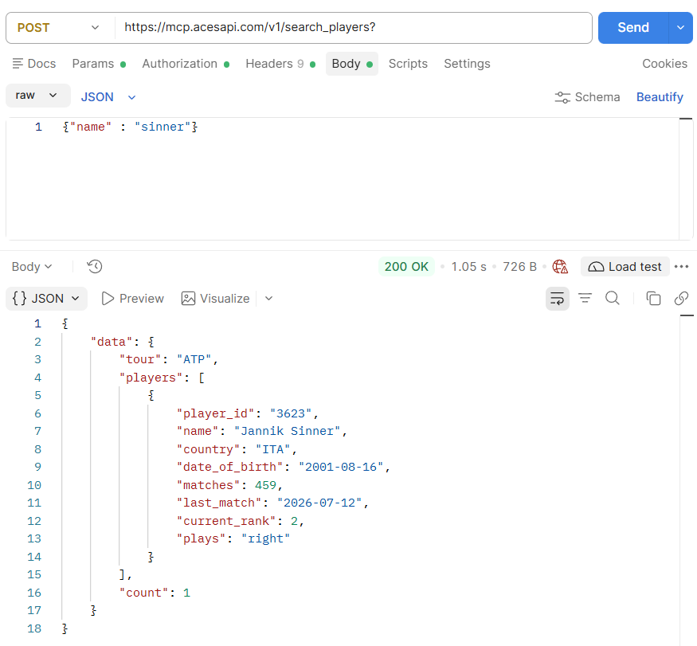
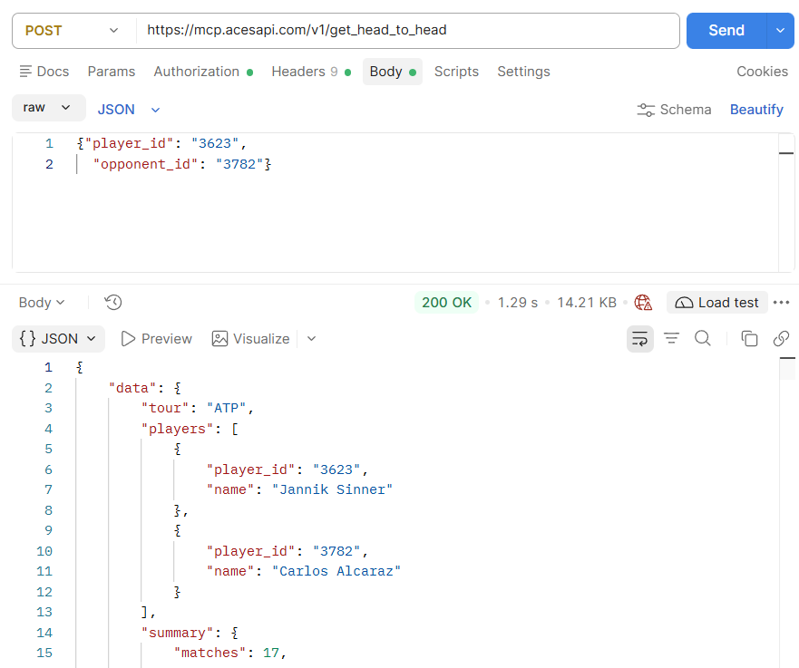
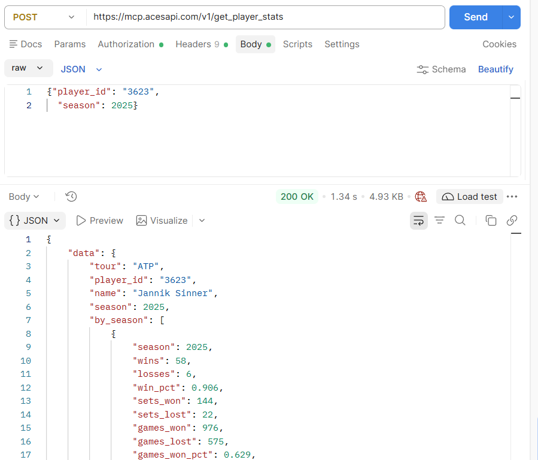
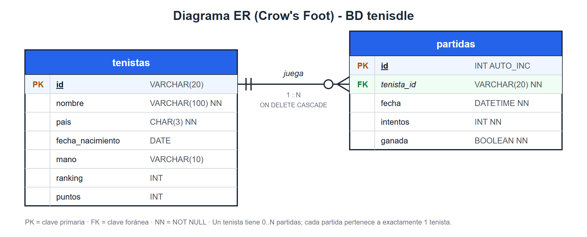

# Proyecto-AcesAPI

## API (AcesAPI)

La aplicación obtiene los datos de [AcesAPI](https://mcp.acesapi.com/v1/). Todas las peticiones son `POST` con un cuerpo JSON y la API key en las cabeceras (se configura en `config.properties`, ver `config.properties.example`).

### `search_players`: buscar tenistas por nombre

```json
{ "name": "sinner" }
```

Devuelve `player_id`, `name`, `country`, `date_of_birth`, `matches`, `last_match`, `current_rank` y `plays`.



### `get_head_to_head`: enfrentamientos entre dos tenistas

```json
{ "player_id": "3623", "opponent_id": "3782" }
```

Devuelve los dos jugadores y un `summary` con el historial de partidos entre ellos.



### `get_player_stats`: estadísticas de un tenista por temporada

```json
{ "player_id": "3623", "season": 2025 }
```

Devuelve en `by_season` las victorias y derrotas, el porcentaje de victorias y los sets y juegos ganados/perdidos.



## Base de datos

Diagrama entidad-relación (notación Crow's Foot) de la BD `tenisdle`:



- **tenistas**: datos de cada tenista descargados de la API (PK `id`).
- **partidas**: cada partida jugada, asociada a un tenista mediante la FK `tenista_id` (`ON DELETE CASCADE`).
- Relación 1:N: un tenista puede tener 0..N partidas; cada partida pertenece a exactamente un tenista.

## Manual técnico para desarrolladores


## Manual de usuario con juego de pruebas

https://github.com/user-attachments/assets/b6cccfbb-a7da-4b52-abe8-320490745183


## Explicación del reparto de las tareas entre ambos integrantes.

Nos repartimos el trabajo por capas: uno se encargó del backend y el otro del frontend. Así cada uno podía avanzar en su parte sin pisar el código del otro. La conexión entre las dos partes son los servicios Java, que la interfaz llama directamente.

**Pablo Souto (backend)**: hizo toda la parte que trabaja con los datos:
- el modelo (`Tenista`, `Partida`, `Intento`, `Pista`…) y los DTOs de la API;
- la configuración (`config.properties`) y la conexión con MySQL, con la creación automática de las tablas;
- el cliente de AcesAPI;
- los repositorios con el CRUD de tenistas y partidas;
- los servicios:
  - `CargaDatosService`, que descarga los datos la primera vez y después los lee de la base de datos;
  - `TenistaService`, con las consultas, filtros, ordenaciones y estadísticas;
  - `JuegoService`, con la lógica del juego y el historial;
- la exportación a CSV y JSON, la versión de consola (`MainConsola`) y los tests del backend.

**Marcos Antonio González Flores (frontend)**: hizo toda la interfaz gráfica con JavaFX (paquete `com.tenisdle.ui`).
- **Estructura:** patrón MVC con vistas FXML, un controlador por pantalla y estilos en CSS. Una clase `Navegador` cambia de pantalla y un `ContextoApp` comparte los servicios entre pantallas.
- **Pantallas:**
  - de inicio, con la carga de datos en segundo plano;
  - de partida, con buscador, contador de intentos y las pistas de colores con flechas;
  - de fin de partida;
  - de estadísticas del historial.
- **Pestaña "Tenistas":** CRUD completo, búsquedas, filtros, ordenaciones y estadísticas.
- **Comportamiento común:** todas las consultas a la base de datos van en segundo plano (`Task`) para que la ventana no se congele, y los errores se muestran con mensajes claros en lugar de cerrar la aplicación.
- **Tests:** los de la lógica de la interfaz.


## Propuestas de mejora: nuevas opciones, control de errores...


## Conclusiones y opinión del trabajo realizado.
