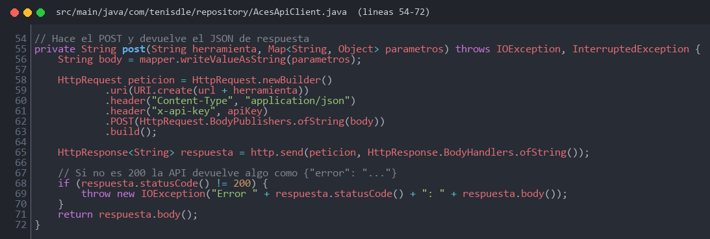
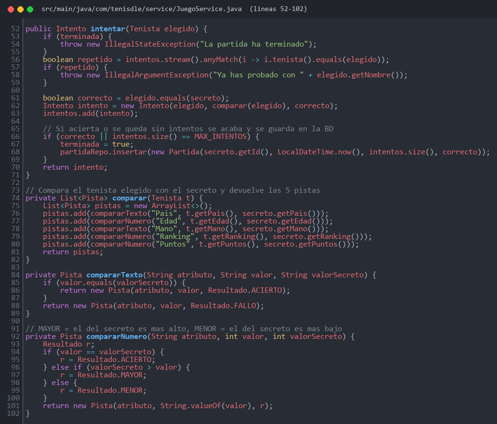
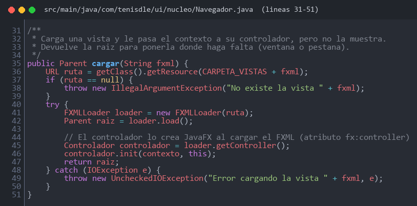
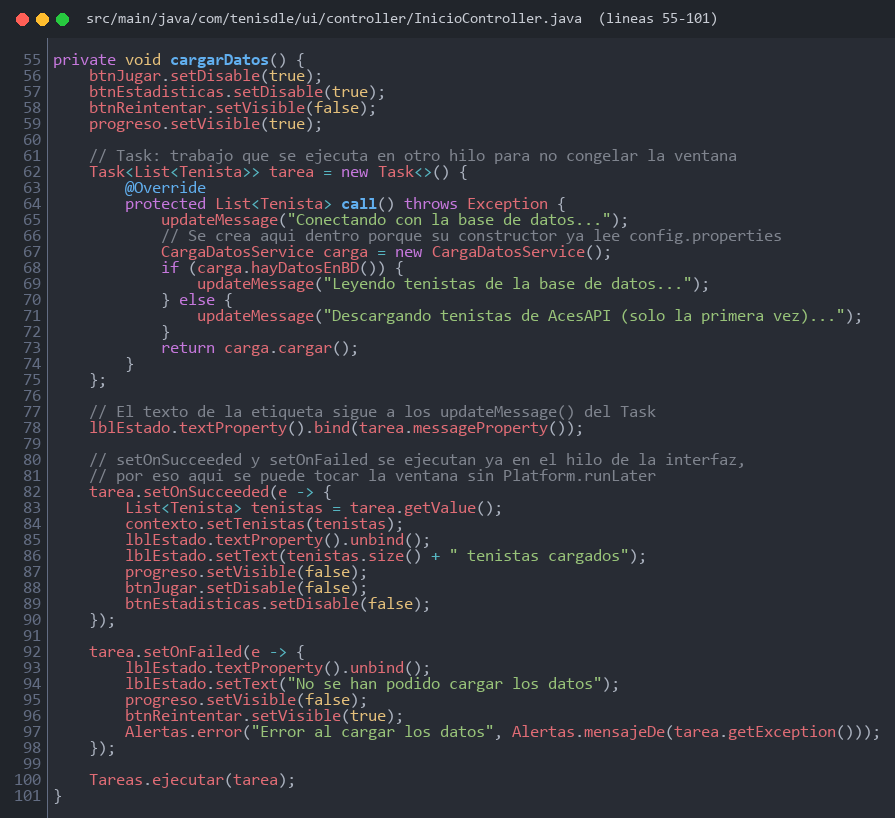

# Manual para desarrolladores

## Puesta en marcha

1. Requisitos: **JDK 21**, Maven y MySQL arrancado.
2. Copia `config.properties.example` como `config.properties` y rellena la API key y los datos de MySQL. La base de datos y las tablas se crean solas.
3. Ejecuta la aplicación con `mvn javafx:run`. Desde el IDE, ejecuta `com.tenisdle.ui.Lanzador`.
4. Los tests se lanzan con `mvn test` y no necesitan MySQL.

La primera vez, los tenistas se descargan de AcesAPI y se guardan en MySQL. A partir de ahí se leen de la base de datos.

## Estructura

| Paquete | Contenido |
|---|---|
| `config` | Lectura de `config.properties` y configuración de Jackson |
| `database` | Conexión a MySQL y creación de las tablas |
| `model` | `Tenista`, `Partida`, `Intento`, `Pista` y los DTOs de la API |
| `repository` | Cliente de AcesAPI y CRUD de tenistas y partidas |
| `service` | Carga de datos, consultas de tenistas y lógica del juego |
| `storage` | Exportación a CSV y JSON |
| `ui` | Interfaz JavaFX: controladores, vistas FXML y CSS |

Cada capa solo usa la de debajo: la interfaz llama a los servicios y nunca accede directamente a la base de datos ni a la API.

## Piezas clave

**Cliente de la API.** Todas las peticiones son `POST` con la API key en la cabecera `x-api-key`:

**Lógica del juego.** Cada intento se compara con el tenista secreto y genera 5 pistas. La partida se guarda cuando el jugador acierta o agota los 8 intentos:

**Navegación.** `Navegador` carga cada vista FXML y llama a `init()` de su controlador para pasarle los servicios:

**Tareas en segundo plano.** Todo lo que consulta MySQL o la API se ejecuta dentro de un `Task`, para que la ventana no se congele:

## Notas

- `MainConsola` se eliminó en el commit `2b0fadc`, pero el `pom.xml` todavía la referencia, así que `mvn exec:java` no funciona.
- Cada petición a la API consume créditos (500 al mes en el plan gratuito). No borres la tabla `tenistas` si no hace falta.
